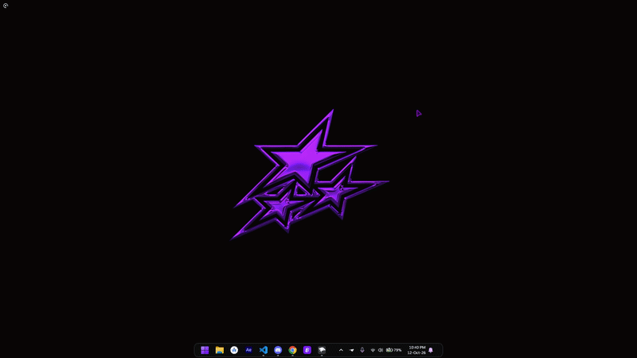

# Magic Pointer

Shake your mouse, select anything on screen, and ask Gemini, ChatGPT, Claude
or a configured OpenAI-compatible cloud provider about it. Magic Pointer brings
the Googlebook-style AI pointer to Windows.

[GitHub](https://github.com/rono-zeroseven) · Discord: **rono007**

**[Install with Windhawk](https://windhawk.net/mods/magic-pointer)**

## What's New

### v1.0.5 — OpenAI-compatible custom providers

You can now configure a cloud provider that implements the OpenAI-compatible
Chat Completions API with **Base URL (OpenAI-compatible)**, **Custom model**,
and that provider's API key. The custom Base URL takes precedence over
API-key auto-detection for Gemini, ChatGPT and Claude.

> **Important — image and math-from-image support is provider/model dependent.**
> “OpenAI-compatible” describes the API format; it does not guarantee that a
> provider accepts image inputs, supports base64 data-URL images, or that its
> selected model can understand images or solve math shown in them. Magic Pointer
> sends selected screenshots as JPEG `image_url` data URLs. For questions about
> screenshots—especially equations or other math—verify that both the provider
> endpoint and the exact model support this image format and have vision and
> math reasoning capabilities. Text-only models may reject or ignore the image;
> the custom-provider path cannot add capabilities the service does not offer.

## Getting started

Install [Windhawk](https://windhawk.net/), open **Explore**, and search for
**Magic Pointer**. Install the mod and adjust its settings to your liking.

1. Shake your mouse or press **Win+Shift+G**.
2. Click a highlighted element, or drag to select an area.
3. Ask a question in the selection card or choose an action.

You can also just start typing right after step 1: the card opens at the pointer
with your text and no image. Turn this off with the **Start typing to ask**
setting.

Press **Esc** or right-click to dismiss the pointer.

## Features

- Ask Gemini, ChatGPT, Claude or a configured OpenAI-compatible cloud provider about images, text, and anything else on screen.
- Start typing as soon as the pointer appears to ask without selecting anything.
- Configure a provider with an API key, Base URL and model.
- Stream answers into the card and ask follow-up questions.
- Open a Gemini browser draft with your selections attached.
- Recognize and copy text with Windows OCR.
- Translate selected text and search images with Google Lens.
- Use your own `.cur` or `.ani` file as the pointer, with the same glow.
- Customize appearance, activation, browser, and excluded apps.
- Speaks 33 languages and follows your Windows display language.

## AI providers

Browser actions work without an API key. Magic Pointer prepares a new Gemini
draft for you to review and send.

Paste an API key in the mod's Windhawk settings to receive answers directly in
the card. You can ask follow-up questions. There is just one **API key**
setting: the mod recognizes which service a key belongs to. To use an
OpenAI-compatible provider, configure its Base URL and model as described below;
that setting takes precedence over automatic key recognition.

- **Gemini**: a free key from [Google AI Studio](https://aistudio.google.com/apikey).
- **ChatGPT**: a key from the [OpenAI platform](https://platform.openai.com/api-keys).
- **Claude**: a key from the [Claude Console](https://platform.claude.com/settings/keys).

To use another cloud provider with an OpenAI-compatible Chat Completions API,
set **Base URL (OpenAI-compatible)** and **Custom model** in Windhawk settings,
and put that provider's API key in **API key**. For example:

| Provider | Base URL |
| --- | --- |
| Groq | `https://api.groq.com/openai/v1` |
| OpenRouter | `https://openrouter.ai/api/v1` |
| Mistral | `https://api.mistral.ai/v1` |
| Agnes AI | `https://apihub.agnes-ai.com/v1` |

Enter the base URL, not the full `/chat/completions` path; the mod adds that
path automatically. HTTPS cloud endpoints are supported. Setting a Base URL
takes precedence over API-key auto-detection, and the **Model** tier setting is
ignored; use the exact model ID provided by your service. Choose a vision-capable
model if you want answers about selected images. Provider model IDs and availability
can change, so check your provider's documentation.

A configured provider handles answers, follow-up questions, Smart suggestions
and Translate. The **Model** setting applies only to Gemini, ChatGPT and Claude:
**Fast** (the default), **Balanced** or **Smartest**. If a chosen built-in model
isn't available, a faster one answers instead.

**Smart suggestions** are optional and disabled by default. When enabled,
the assistant suggests up to three things to do with each selection.

### Custom-provider errors

- **Invalid Base URL:** enter an HTTPS cloud base URL without a query or
  fragment. The mod appends `/chat/completions`; localhost and loopback URLs
  are not supported.
- **Model or endpoint not found:** check both the provider's Base URL and the
  exact model ID copied from its current catalog.
- **Rejected API key:** confirm the key belongs to the provider selected by
  the custom Base URL. A custom Base URL overrides API-key auto-detection.
- **Unsupported image:** the provider and model must accept `image_url` JPEG
  data URLs and support vision. Math-from-image ability is a separate model
  capability; use a vision model with suitable math reasoning.
- **Rate limit:** wait and retry, and check the provider's usage limits or
  account quota. The mod reports provider rate-limit responses; it does not
  guarantee a retry will succeed.

## Languages

The hint, the card, its buttons and its messages appear in your Windows display
language, or in the language you choose with the **Language** setting. The
settings page is translated too, in the languages Windhawk itself offers.

Available: English, Arabic, Bengali, Chinese (Simplified and Traditional),
Croatian, Czech, Danish, Dutch, Finnish, French, German, Greek, Hebrew, Hindi,
Hungarian, Indonesian, Italian, Japanese, Korean, Norwegian, Persian, Polish,
Portuguese (Brazil), Romanian, Russian, Spanish, Swedish, Tamil, Thai, Turkish,
Ukrainian and Vietnamese. Any other language shows English.

The translations were written with the help of AI, and not every one has been
checked by a native speaker. To fix or improve a text, or to add a language,
[open an issue](https://github.com/rono-zeroseven/magic-pointer/issues).

## Privacy

Text recognition runs locally. Gemini and Google Lens actions send the selected
content to Google's services. With an API key, asking, suggestions and
Translate send it to the service configured by the API key or custom Base URL.
Enabling Smart suggestions with an API key sends each selection to that service
automatically. See the
[mod documentation](https://windhawk.net/mods/magic-pointer) for the full privacy
and temporary-file details.

## Report a problem

[Open an issue](https://github.com/rono-zeroseven/magic-pointer/issues) with your
Windows version, Windhawk version, Magic Pointer version, and steps to reproduce
the problem. Include screenshots when useful and remove private content.

## Changelog

### v1.0.5

- Added Base URL and Custom model settings for cloud OpenAI-compatible Chat
  Completions APIs.
- Added streamed answers and JPEG data-URL image payloads for providers and
  models that support them.
- Kept built-in Gemini, ChatGPT and Claude routing unchanged when the custom
  Base URL is empty.
- Documented that API-format compatibility does not guarantee image input or
  math-from-image capability; check both provider and model before relying on
  screenshot questions.

## License

[MIT](LICENSE) · [Rono](https://github.com/rono-zeroseven)
