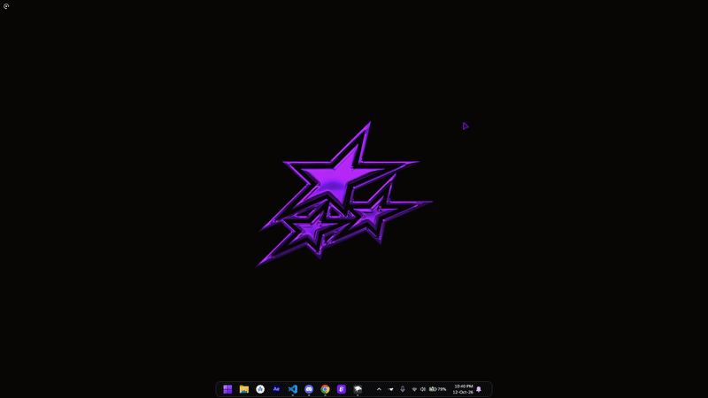

# Magic Pointer

Shake your mouse, select anything on screen, and ask Gemini about it.
Magic Pointer brings the Googlebook-style AI pointer to Windows.

[GitHub](https://github.com/rono-zeroseven) · Discord: **rono007**

**[Install with Windhawk](https://windhawk.net/mods/magic-pointer)**

## Getting started

Install [Windhawk](https://windhawk.net/), open **Explore**, and search for
**Magic Pointer**. Install the mod and adjust its settings to your liking.

1. Shake your mouse or press **Win+Shift+G**.
2. Click a highlighted element, or drag to select an area.
3. Ask a question in the selection card or choose an action.

Press **Esc** or right-click to dismiss the pointer.

## Features

- Ask Gemini about images, text, and anything else on screen.
- Stream answers into the card and ask follow-up questions.
- Open a Gemini browser draft with your selections attached.
- Recognize and copy text with Windows OCR.
- Translate selected text and search images with Google Lens.
- Customize appearance, activation, browser, and excluded apps.
- Speaks 33 languages and follows your Windows display language.

## Gemini

Browser actions work without an API key. Magic Pointer prepares a new Gemini
draft for you to review and send.

Add an API key from [Google AI Studio](https://aistudio.google.com/apikey) in the
mod's Windhawk settings to receive answers directly in the card. You can ask
follow-up questions.

**Smart suggestions** are optional and disabled by default. When enabled,
Gemini suggests up to three things to do with each selection.

## Languages

The hint, the card, its buttons and its messages appear in your Windows display
language, or in the language you choose with the **Language** setting. The
settings page is translated too, in the languages Windhawk itself offers.

Available: English, Arabic, Bengali, Chinese (Simplified and Traditional),
Croatian, Czech, Danish, Dutch, Finnish, French, German, Greek, Hebrew, Hindi,
Hungarian, Indonesian, Italian, Japanese, Korean, Norwegian, Persian, Polish,
Portuguese (Brazil), Romanian, Russian, Spanish, Swedish, Tamil, Thai, Turkish,
Ukrainian and Vietnamese. Any other language shows English.

The translations were written with the help of AI, and not every one has been
checked by a native speaker. To fix or improve a text, or to add a language,
[open an issue](https://github.com/rono-zeroseven/magic-pointer/issues).

## Privacy

Text recognition runs locally. Gemini and Google Lens actions send the selected
content to Google's services. Enabling Smart suggestions with an API key sends
each selection to Gemini automatically. See the
[mod documentation](https://windhawk.net/mods/magic-pointer) for the full privacy
and temporary-file details.

## Report a problem

[Open an issue](https://github.com/rono-zeroseven/magic-pointer/issues) with your
Windows version, Windhawk version, Magic Pointer version, and steps to reproduce
the problem. Include screenshots when useful and remove private content.

## License

[MIT](LICENSE) · [Rono](https://github.com/rono-zeroseven)
