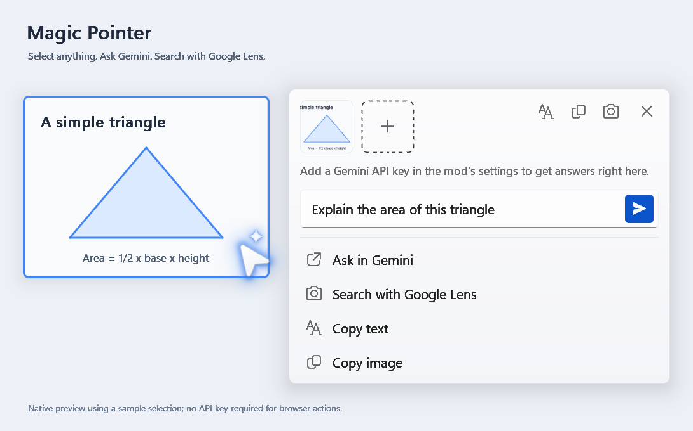

# Magic Pointer

Shake your mouse, select anything on screen, and ask Gemini about it.
Magic Pointer brings the Googlebook-style AI pointer to Windows.

**[Install with Windhawk](https://windhawk.net/mods/magic-pointer)**

## Getting started

Install [Windhawk](https://windhawk.net/), open **Explore**, and search for
**Magic Pointer**. Install the mod and adjust its settings to your liking.

1. Shake your mouse or press **Win+Shift+G**.
2. Click a highlighted element, or drag to select an area.
3. Ask a question in the selection card or choose an action.

Press **Esc** or right-click to dismiss the pointer.

## Features

- Ask Gemini about images, text, and anything else on screen.
- Stream answers into the card and ask follow-up questions.
- Open a Gemini browser draft with your selections attached.
- Recognize and copy text with Windows OCR.
- Translate selected text and search images with Google Lens.
- Customize appearance, activation, browser, and excluded apps.

## Gemini

Browser actions work without an API key. Magic Pointer prepares a new Gemini
draft for you to review and send.

For answers directly in the card, add a
[Gemini API key](https://aistudio.google.com/apikey) in the mod's Windhawk
settings. Smart suggestions are optional and disabled by default.

## Privacy

Text recognition runs locally. Gemini and Google Lens actions send the selected
content to Google's services. Enabling Smart suggestions with an API key sends
each selection to Gemini automatically. See the
[mod documentation](https://windhawk.net/mods/magic-pointer) for the full privacy
and temporary-file details.

## License

[MIT](LICENSE) · [Rono](https://github.com/rono-zeroseven)
